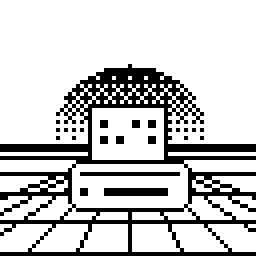

<p align="center"></p>

# Dotlab

A label studio in your browser for cheap Bluetooth thermal label printers, with a live 1-bit preview of exactly what the
printer will burn. Text, QR codes and images, plus a pile of early-web and cyberpunk styling, and every font can print
Japanese (日本語). Nothing to install: open the page, design, print.

**→ <https://minombreespablo.github.io/dotlab/>**

The first (and so far only) supported printer is the **ORGBRO T003**. The name says "dot" because that is all the
printer has: 384 of them across a 58 mm sticker.

## What this is

A fun, Y2K-flavoured label studio: made by a hobbyist for the joy of it, and open to anyone who likes the same corner of
the internet. It aims to stay small and playful. A new feature should be **fun**, or **small and useful**; heavier
"serious label software" ideas (batch printing, databases, accounts) are tagged on the roadmap and only happen if they
stay simple and are fun to build. It's maintained as a hobby, best effort, and nothing here is a promise. Kind issues
and pull requests are welcome.

## Where it works

Printing is **Bluetooth only**, on purpose: it behaves the same everywhere, unlike USB, which needs a different driver
story on every system. In the browser that means Web Bluetooth (BLE), or on desktop also Web Serial over classic Bluetooth, which is what Linux uses.

| Device | Browser | Print from the page? |
|---|---|---|
| **Android** | Chrome or Edge | ✅ Works. Tested on a Pixel 7a with the real printer. |
| **Windows** | Chrome or Edge | ❔ Should work (Web Bluetooth, or Bluetooth serial after pairing). Not tested yet. |
| **macOS** | Chrome or Edge | ❔ Should work. Not tested yet. |
| **ChromeOS** | Chrome | ❔ Should work. Not tested. |
| **Linux** | Chrome, Chromium | ✅ Works, over Bluetooth serial. Pair the printer in your system's Bluetooth settings once; the browser then lists it. Tested with Chromium 156. |
| **iPhone, iPad** | any | ❌ iOS has no Web Bluetooth in Safari or Chrome. A third-party Web Bluetooth browser (e.g. Bluefy) may work; untested. |
| **Firefox, Safari** | any system | ❌ No Web Bluetooth. You can still design, and save the label as an image. |

Designing works in every modern browser; only the Print button needs Web Bluetooth or Web Serial. The page runs the label engine
(Python, via [Pyodide](https://pyodide.org)) in your browser: the first visit downloads the engine and takes a few
seconds (fonts load as you use them), and nothing you make leaves your device. A service worker keeps the runtime, so repeat visits start faster and the page loads without a network.

## Features

- **Live 1-bit preview** that is the same bitmap that gets printed (what you see is what you stick).
- **Text:** 23 bundled open-licence fonts in five groups (Cyber, Pixel, Early web, Display, Clean), bold/italic, size,
  left/centre/right and top/middle/bottom alignment. Latin-only fonts borrow kana and kanji from Zen Kaku Gothic New;
  DotGothic16, Yusei Magic, Dela Gothic One and Stick have their own Japanese.
- **Effects:** dithered shadow, outline, 3D WordArt, glitch, neon glow, scanline text.
- **Backgrounds:** checker, dots, stripes, dithered gradient, stars, graph paper, scanlines, circuit board, hex grid,
  synthwave sun, vaporwave checkerboard floor, matrix rain, halftone, bricks, waves, zigzag, diamonds, rings, crosshatch, TV static. **Borders:** solid, double, dotted, checker, Win95 bevel, marquee lights,
  cyber panel, HUD brackets, ruler ticks. **Bars:** under-construction hazard stripes.
- **Layers:** text, pictures, QR codes and stickers are all layers, as many as you like (up to 48). Click one on the label to
  select it, drag to move, drag the corner to resize, arrow keys nudge and Delete removes it; the same inspector edits any
  of them (position, size, rotate in quarter turns, mirror, flip upside down, order, show/hide, duplicate) plus what is specific to its kind. The **Paper** entry at the
  bottom of the list holds the background, border and bars. Copies, darkness and saved **presets** are next to the Print
  button.
- **Pictures:** drag one in, paste it (Ctrl+V) or browse. A picture layer can fill its box (text over it gets a white
  halo). Floyd–Steinberg, Atkinson (the crisp first-Mac look), ordered (Bayer) crosshatch or hard-cutoff dithering;
  brightness, contrast, gamma, pixelate, mirror, flip and invert. **Transparent PNGs stay see-through**, so the paper
  and the layers below show through; **Remove background** does the same for a flat-colour background (a screenshot,
  a logo on white) with one slider. Phone photos keep their orientation.
- **Doodle:** freehand ink on the label with brushes, spray, outlined or filled shapes, a paint bucket, 18 dither patterns to paint with (bricks, waves, plus signs, TV static…), Shift for straight lines, squares and circles, a snap-to-grid graph paper mode, with undo and redo (Ctrl+Z, Ctrl+Shift+Z or Ctrl+Y).
- **Remembers your work:** the label you were designing is back when you reopen the page (its picture isn't kept: *Save* keeps pictures). *File → New label* starts over.
- **Save and share:** *Save* writes the label as a normal 1-bit **PNG** with the whole design stored inside it. Any
  image viewer or editor opens it as a picture; Dotlab opens it again for editing (*Open label*, or drop it on the
  page). *Copy image* puts the label on the clipboard, at printed size or enlarged 4×.
- Looks: Y2K candy plastic in blue or pink, pastel Vaporwave, gunmetal with LCD-green text, a four-shade olive "handheld" look, or a plain, light
  look that ignores your OS theme.

## How it works

The T003 speaks TSPL. Dotlab renders a 384×224 dot label (58 mm paper, 203 dpi, 28 mm stickers), turns it into a TSPL
bitmap and sends it over Bluetooth: Web Bluetooth (GATT) or Web Serial (RFCOMM) from the page. See
[AGENTS.md](AGENTS.md) for the hardware facts and the code layout.

## From source

```bash
python -m venv .venv && .venv/bin/pip install -e '.[dev]'   # [dev] = pytest
python src/dotlab/web/dev_server.py                          # the page at http://localhost:8000 (Web Bluetooth needs localhost or https)
.venv/bin/pytest                                             # tests, no printer needed
```

On a phone, `adb reverse tcp:8000 tcp:8000` makes `http://localhost:8000` reach your computer's dev server.

## Roadmap

Ordered by priority, with no promised dates. Several ideas are inspired by 90s handheld cameras and their thermal
printers. Each item has tags: `fun` (it's about play), `useful` (it makes the app handier), `polish` (a small quality
fix), `infra` (builds, packaging, CI), `research` (needs hardware or a question answered first) and `big` (a lot of
work to build and to keep working).

**Next**
- [ ] `research` Check Print from Chrome/Edge on real Windows and macOS machines, and fix what turns up. Testers wanted.
- [ ] `useful` Open Recent (the page already remembers the label you were on, minus its picture)
- [x] `fun` More stickers (79, in themed groups), and every element a movable, resizable layer
- [ ] `fun` Poster mode: split one large image across several stickers, with alignment marks

**Later**
- [ ] `useful` `big` Batch-print from a CSV (`{column}` placeholders in the text and QR fields)
- [ ] `useful` `big` Undo/redo for the whole label (the Doodle tab has its own), then an album: recent and saved labels as a thumbnail gallery
- [ ] `polish` Presets (kept in the browser) and label files overlap: merge them or make the difference obvious
- [ ] `fun` More themes: Win95/98 grey, and user-defined colour themes
- [ ] `useful` Zoomable preview with a ruler/grid overlay
- [ ] `fun` `big` Webcam capture: take a photo and print it (`getUserMedia`)
- [ ] `polish` Accessibility pass: name the remaining controls, try Orca and NVDA, and show a checkbox's state with a tick as well as colour
- [ ] `polish` A keyboard-shortcuts window (Ctrl+?)

**Needs hardware or research first**
- [ ] `research` Other label sizes and continuous paper: a plain roll prints, but the printer then shows "Label error" and ignores further jobs until restarted (see AGENTS.md); needs a new idea before any size option
- [ ] `research` Printing from iOS through a Web Bluetooth browser such as Bluefy
- [ ] `research` Check Bluetooth serial on Windows and macOS Chrome (Web Bluetooth should work there too)
- [ ] `research` Other cheap Bluetooth thermal printers (the page's printer code is mostly TSPL plus a few UUIDs)

## Licence

MIT for the code (see [LICENSE](LICENSE)). The bundled fonts keep their own licences, mostly the SIL Open Font
License; all texts are in `src/dotlab/fonts/LICENSES/`. Most stickers are tiles from [Kenney's 1-Bit Pack](https://kenney.nl/assets/1-bit-pack) (CC0, public domain; text in `src/dotlab/assets/LICENSE.kenney-1-bit-pack.txt`).
